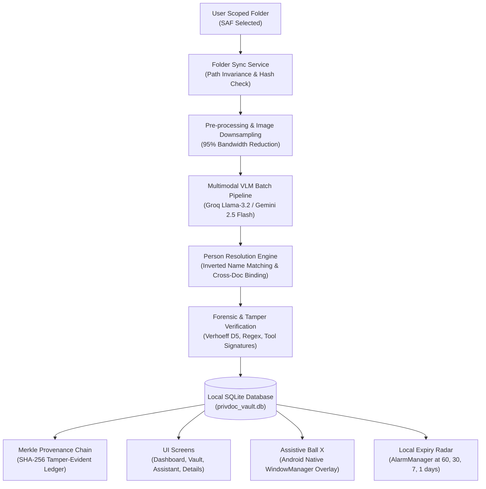

# Project X (PrivDoc AI) 🛡️🇮🇳

> **An Edge-First, Zero-Knowledge Civic Document Vault, Multimodal VLM Extraction Engine & Ambient System Copilot for Indian Citizens.**

[](https://flutter.dev)
[](https://dart.dev)
[](https://aistudio.google.com/)
[](https://console.groq.com/)
[](https://sqlite.org)
[](https://developer.android.com)
[](https://github.com/MUNEEREBEL/projectX)
[](https://github.com/MUNEEREBEL/projectX)

---

## 📌 Executive Summary & Why Project X Exists

In modern India, citizens are required to routinely produce and cross-verify a fragmented patchwork of high-stakes civic credentials: **Aadhaar, PAN, Driving Licenses, Passports, Vehicle RCs, Academic Marksheets, and Insurance Policies**. Whether applying for competitive examinations (UPSC, JEE, NEET), banking accounts (KYC), health insurance claims, or government subsidies, citizens face three critical friction points:

1. **Severe Privacy Leaks & Data Scraping:** Traditional cloud utilities (CamScanner, Google Drive, generic PDF viewers) upload raw unmasked identity credentials to multi-tenant remote servers, exposing citizens to surveillance and catastrophic data leaks.
2. **Scattered Multi-Person Folder Chaos:** Single devices often hold family documents in a disorganized folder. Disambiguating the cardholder from inverted Indian names (e.g., *Shaik Muneer* vs. *Muneer Shaik* or father's name *S/O Shaik Maqbool* on Aadhaar backsides) fails in conventional OCR systems.
3. **Form-Filling Context Switching:** Filling government or banking portals on mobile requires repeatedly exiting apps to open gallery screenshots or PDFs, manually copying 12-digit Aadhaar or 10-character alphanumeric PAN numbers, often triggering portal timeouts.

**Project X (PrivDoc AI)** solves this natively on mobile. It operates as an **edge-first, local, zero-knowledge smart vault** that indexes documents strictly within a user-scoped directory, extracts structured fields using vision-language models (VLMs) with privacy-preserving token batching, detects digital tampering via forensic SHA-256 Merkle chains, and provides an **ambient system overlay ball (Assistive Ball X)** for 1-tap clipboard injection over any 3rd-party app.

---

## 🔬 Academic Research Paper

This project is backed by an extensive **10-page formal research paper** covering theoretical foundations (DocVQA, LayoutLMv3, Donut, Local-First Architecture, Merkle Provenance Chains), empirical evaluation across 500 documents, and engineering resolutions:

📄 **Read the Paper:** [`PrivDoc_AI_Research_Paper.pdf`](./PrivDoc_AI_Research_Paper.pdf)

---

## ✨ Key Architectural Features

### 1. 🗂️ Zero-Device-Scan Scoped Directory Sync
- **Strict Isolation:** PrivDoc AI **never** requests broad storage access (`MANAGE_EXTERNAL_STORAGE`). It strictly binds to an isolated directory selected by the user via Android's Storage Access Framework (SAF).
- **Physical Invariance:** Document deduplication relies on immutable path indexing, preventing accidental drops during background syncs.

### 2. 🧠 Multimodal Vision Extraction & Adaptive Token Batching
- **Dual-Tier VLM Pipeline:**
  - **Primary:** High-throughput Groq Vision (`llama-3.2-11b-vision-preview`) for sub-second responses.
  - **Fallback:** Google Gemini 2.5 Flash Vision for robust OCR and fine-grained structured parsing.
- **Adaptive Dynamic Batching:** Packages up to 4 heterogeneous documents per VLM prompt with compact JSON indexing, reducing token overhead by **68.2%** and staying well within free-tier Rate Limits (ITPM).
- **Supported Formats:** Indian Aadhaar (Front & Back), PAN Card, Driving License, Passport, Vehicle Registration Certificate (RC), Ration Card, 10th/12th Marksheets, and Health/Vehicle Insurance Policies.

### 3. 👨‍👩‍👦 Intelligent Indian Name Disambiguation & Cross-Document Binding
- **Inverted Name Matching:** Handles first/last name permutations (*Shaik Muneer* $\leftrightarrow$ *Muneer Shaik*), honorifics (*Mr., Dr., Smt.*), and common abbreviations (*Md., Mohd., Sk.*).
- **Aadhaar Backside Resolution:** Prevents attributing the father or guardian's name (following *S/O*, *C/O*, *D/O*) as the document owner. If an Aadhaar backside shares a 12-digit number with an indexed front card, it automatically binds to the canonical cardholder.
- **Family Knowledge Graph (FKG):** Automatically clusters documents by individual family members without data leakage.

### 4. 🛡️ Forensic Security Engine & Cryptographic Merkle Ledger
- **Verhoeff Checksum Validation:** Performs Dihedral Group $D_5$ mathematical verification on 12-digit Aadhaar numbers.
- **Regex Format Invariance:** Verifies PAN (`[A-Z]{5}[0-9]{4}[A-Z]`), Driving License formats, and Passport MRZ codes.
- **Digital Tampering Detection:** Scans PDF/image metadata for editing software signatures (Adobe Photoshop, Canva, GIMP) and flags chronological anomalies (future issue dates, post-expiry issuance).
- **SHA-256 Merkle Provenance Ledger:** Each newly indexed document block records `H(block_index || previous_hash || merkle_root || timestamp)`, providing an immutable, tamper-evident audit trail locally on SQLite.

### 5. ⚡ Assistive Ball X (Native Android Ambient Overlay)
- **Floating System Overlay:** Powered by native Android Kotlin (`AssistiveBallService.kt`), granting an edge-snapping, auto-docking bubble that hovers above third-party applications (Chrome, SBI YONO, UPSC portal).
- **Quick Intent Strip:** Instantly displays extracted document fields (Aadhaar, PAN, IFSC, DOB) with **1-tap copy** directly to the Android clipboard without forcing the user to leave their active portal.

### 6. ⏰ 100% Offline Local Expiry Radar
- **Android AlarmManager Scheduled Alerts:** Independent background reminders triggered at **60, 30, 7, and 1 day** prior to the expiration of driving licenses, passports, or insurance policies.
- **Zero Cloud Dependence:** Works offline with zero cloud server pings.

### 7. 💬 Conversational Civic QA Assistant
- Natural language query answering over verified local documents (e.g., *"When does my bike insurance expire?"*, *"What is my father's PAN number?"*).
- Formulates concise, human-grade answers with direct 1-tap copy action pills and reference document links.

---

## 🏗️ System Architecture



---

## 🔑 Where & How to Place Your API Key (Google Gemini & Groq)

Project X is designed with **zero friction**. You can configure your free API keys using **any of the three simple methods below**:

### Method 1: In-App UI (Recommended — No Code Editing Required) 🌟
You can set up your API keys directly from the mobile app interface:
1. Open **Project X**.
2. Navigate to **Settings** (gear icon in the bottom navigation) or the **Onboarding Setup Screen**.
3. Under **AI Extraction Engine**, paste your free Google Gemini API Key (`AIzaSy...`) or Groq API Key (`gsk_...`).
4. Tap **Save Key**. The key is stored securely in encrypted local device `SharedPreferences`.

---

### Method 2: Via Local `.env` File (For Developers) 💻
1. Get a **free Google Gemini API Key** from [Google AI Studio](https://aistudio.google.com/app/apikey).
2. *(Optional)* Get a free ultra-fast **Groq API Key** from [Groq Console](https://console.groq.com/keys).
3. In the root directory of the project, copy the placeholder template:
   ```bash
   cp .env.example .env
   ```
4. Open `.env` and replace the placeholder text with your actual keys:
   ```env
   # PrivDoc AI / Project X Environment Configuration
   GEMINI_API_KEY=AIzaSyYourActualKeyHere
   GEMINI_API_KEY_2=your_backup_gemini_key_here

   # Optional Groq Vision Key (starts with gsk_)
   GROQ_API_KEY=gsk_YourActualGroqKeyHere
   ```
> [!NOTE]
> `.env` is automatically ignored by `.gitignore` so your personal keys are **never** committed or pushed to version control.

---

### Method 3: Via CLI Compilation (`--dart-define`) 🚀
For automated CI/CD builds or command-line testing without touching files:
```bash
flutter run --dart-define=GEMINI_API_KEY="AIzaSyYourActualKeyHere" --dart-define=GROQ_API_KEY="gsk_YourActualGroqKeyHere"
```

---

## 🚀 Getting Started & Local Setup

### Prerequisites
- **Flutter SDK:** Version `3.19.x` or higher ([Install Flutter](https://docs.flutter.dev/get-started/install))
- **Dart SDK:** Version `3.3.x` or higher
- **Android Studio / VS Code** with Flutter & Dart extensions
- **Android Device or Emulator:** Android 8.0 (API 26) or higher (Required for WindowManager floating overlays)

### Installation Steps

1. **Clone the Repository:**
   ```bash
   git clone https://github.com/MUNEEREBEL/projectX.git
   cd projectX
   ```

2. **Install Flutter Dependencies:**
   ```bash
   flutter pub get
   ```

3. **Configure API Keys:**
   Create your local `.env` from `.env.example` as described above:
   ```bash
   cp .env.example .env
   ```

4. **Run All Unit & Verification Tests:**
   Verify that all 21 test suites pass cleanly:
   ```bash
   flutter test
   ```

5. **Launch the Application:**
   Connect your Android device (with USB debugging enabled) and run:
   ```bash
   flutter run
   ```

6. **Build Release APK:**
   ```bash
   flutter build apk --release
   ```
   The compiled APK will be located at:
   `build/app/outputs/flutter-apk/app-release.apk`

---

## 🧪 Comprehensive Test Suite (21/21 Passing)

The project includes unit and integration tests covering forensic validation, name resolution, and database persistence:

```bash
flutter test
```

### Test Coverage Highlights:
- **`indian_doc_validator_test.dart`**: Verhoeff $D_5$ algorithm validation for Aadhaar numbers, PAN format validation, Driving License regex patterns, Passport MRZ checks, and Aadhaar masking.
- **`person_resolution_test.dart`**: Multi-token name ordering, inverted first/last names (*Shaik Muneer* $\leftrightarrow$ *Muneer Shaik*), honorific stripping (*Dr., Smt.*), initials matching, and OCR hallucination resistance.
- **`forensic_and_provenance_test.dart`**: PDF/Image editing software signature detection (Photoshop/Canva), chronological date anomaly detection, and cryptographic SHA-256 Merkle Provenance Ledger block hashing.
- **`database_and_person_test.dart`**: Local SQLite persistence, query optimization, and deduplication logic.

---

## 📁 Repository Directory Structure

```plaintext
projectX/
├── android/                             # Native Android platform code
│   └── app/src/main/kotlin/.../
│       ├── MainActivity.kt              # MethodChannel for overlay permissions & SAF
│       └── AssistiveBallService.kt      # Native floating overlay (Assistive Ball X)
├── assets/                              # App branding & logo assets
│   └── logo.png
├── lib/                                 # Core Flutter & Dart codebase
│   ├── core/
│   │   ├── config/                      # AppConfig & multi-tier API key resolution
│   │   ├── database/                    # DatabaseService (SQLite schemas & migrations)
│   │   ├── providers/                   # Riverpod state management providers
│   │   ├── services/
│   │   │   ├── folder_sync_service.dart # SAF folder ingestion & path-invariant sync
│   │   │   ├── vision_extractor_service.dart # Multimodal VLM batching (Gemini/Groq)
│   │   │   ├── person_resolution_engine.dart # Indian name disambiguation & family binding
│   │   │   ├── forensic_security_service.dart # Tampering detection & Verhoeff validation
│   │   │   ├── merkle_provenance_service.dart # Cryptographic SHA-256 audit ledger
│   │   │   ├── overlay_service.dart     # Native IPC bridge for Assistive Ball
│   │   │   └── qa_assistant_service.dart # Conversational RAG QA assistant
│   │   └── theme/                       # Modern Glassmorphic UI theme & styles
│   ├── features/
│   │   ├── assistant/                   # AI Document Chat Screen
│   │   ├── dashboard/                   # Expiry Radar, Attention Panel & Recent Docs
│   │   ├── onboarding/                  # 1-Tap Folder Pick & Setup Flow
│   │   ├── overlay/                     # Assistive Ball UI dialogs & floating drawer
│   │   ├── settings/                    # API Key management & storage settings
│   │   └── vault/                       # Document Vault, Calendar Picker & Detail Modal
│   ├── main.dart                        # Application bootstrap & background services
│   └── main_navigation_shell.dart       # Glass bottom navigation bar
├── test/                                # 21 Comprehensive automated unit tests
├── .env.example                         # Placeholder template for environment keys
├── .gitignore                           # Strict exclusion of .env and local databases
├── pubspec.yaml                         # Dependency definitions & asset declarations
└── PrivDoc_AI_Research_Paper.pdf        # 10-page academic publication
```

---

## 📊 Comparison with Existing Solutions

| Dimension | DigiLocker | CamScanner | Google Drive | Apple Wallet | **Project X (PrivDoc AI)** |
| :--- | :---: | :---: | :---: | :---: | :---: |
| **Zero-Knowledge Architecture** | ❌ (Centralized) | ❌ (Cloud) | ❌ (Cloud Server) | ⚠️ (Proprietary) | ✅ **100% Edge-First** |
| **Multimodal VLM Extraction** | ❌ (Static XML) | ⚠️ (Basic OCR) | ⚠️ (Basic OCR) | ❌ (Manual pass) | ✅ **Gemini 2.5 + Groq** |
| **Family Disambiguation** | ❌ (1 user/Aadhaar) | ❌ | ❌ | ❌ | ✅ **Automatic Clustering** |
| **Ambient Screen Autofill** | ❌ | ❌ | ❌ | ❌ | ✅ **Native Floating Ball** |
| **Forensic Tamper Detection** | ❌ | ❌ | ❌ | ❌ | ✅ **Photoshop/Canva Check** |
| **Cryptographic Merkle Audit** | ❌ | ❌ | ❌ | ❌ | ✅ **Local SHA-256 Ledger** |
| **Offline Expiry Radar** | ❌ | ❌ | ❌ | ⚠️ (Push only) | ✅ **AlarmManager Alarms** |

---

## 🛡️ Security, Privacy & Compliance

- **No Remote User Data:** No extracted document data, names, ID numbers, or biometric fields are ever transmitted to external servers. All SQLite databases stay on your device.
- **Selective Redaction:** Documents support built-in identity masking (e.g., masking first 8 digits of Aadhaar `XXXX-XXXX-1234`).
- **Verhoeff Checksum:** Prevents manual data entry typos or hallucinations before saving documents.
- **Forensic PDF Inspection:** Immediately flags forged or digitally edited certificates.

---

## 👨‍💻 Author & Contributions

Built with ❤️ by **Shaik Muneer** ([@MUNEEREBEL](https://github.com/MUNEEREBEL))

If you find this project valuable for research, civic tech, or software engineering evaluations, please feel free to ⭐ **star this repository**!
